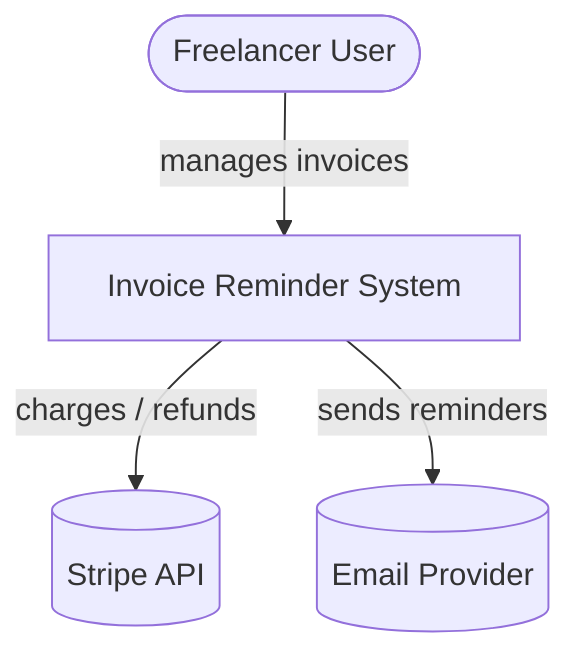
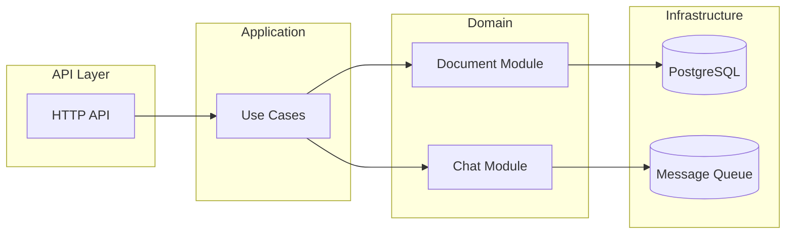
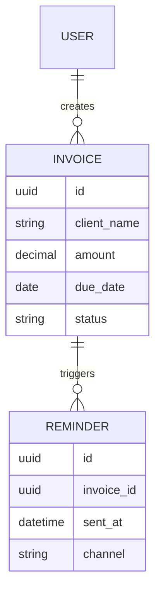
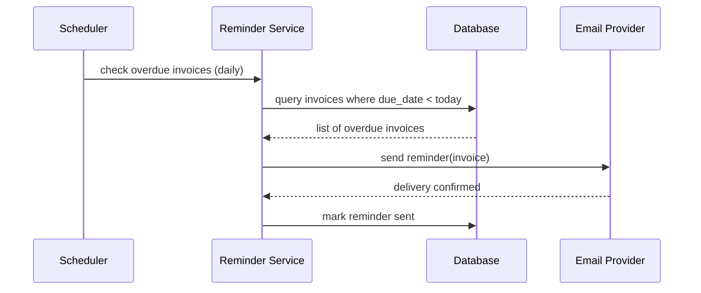
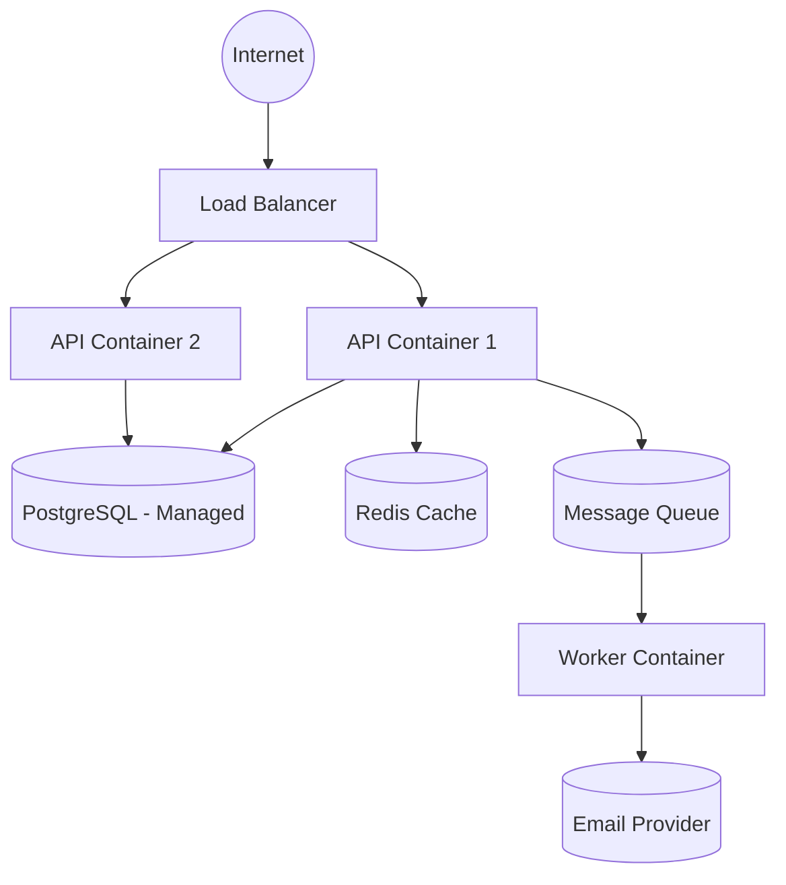

# BMAD Architecture Discovery Checklist

The canonical, reusable reference for running `bmad-architecture` with full coverage instead of relying on memory. Winston loads this file during architecture work — **before the spine is produced** — and drives the prefill → verify → diagram flow section by section. Feed this whole file to the Architect as your scope brief, or use it yourself to review its output.

---

## The Workflow

1. **Prefill.** Before touching the checklist, ask the Architect (or do it yourself) to scan `prd.md` (+ `ux-spec.md`, `project-context.md` if present) and draft a first-pass answer for every section below into a scratch file: `architecture-discovery.md`. Every answer starts tagged `[DRAFT - from PRD]` or `[UNKNOWN - needs your input]`. Nothing here is trusted yet.
2. **Verify section by section.** Go through the checklist below in order. For each section: confirm, correct, or answer the open question. Only once you've confirmed it, tag it `[VERIFIED]`. Generate the diagram for that section now, while the decision is fresh, not in a batch at the end.
3. **Populate the spine.** Once every section is `[VERIFIED]`, the confirmed content moves into `ARCHITECTURE-SPINE.md` (decisions + rules) and `project-context.md` (implementation rules for downstream agents). Diagrams live in `diagrams/`.
4. **Delete the scratch file.** `architecture-discovery.md` has no further job once the spine exists — keeping it around just creates a second place that can go stale. Delete it. The spine and diagrams are now the only source of truth.
5. **Re-run only the affected section** later via `correct-course` if reality contradicts a decision — don't regenerate the whole discovery file from scratch.

---

## Section-by-Section Checklist

Each row: what to resolve → expected answer shape → diagram needed?

**Enum Legend** — use these codes anywhere you reference a section (index tables, diagram filenames, notes, `correct-course` change logs) instead of section numbers, since numbers shift if sections get reordered later.

| Code | Section |
|---|---|
| ASP | Architecture Style & Principles |
| SCD | System Context |
| MBD | Module / Component Boundaries |
| DPR | Dependency Rules |
| TLD | Technology & Library Decisions |
| RFS | Repository / File Structure |
| ADC | API / DTO Contract Strategy |
| DTA | Data Architecture |
| AEC | Async / Event Communication |
| ASB | Auth & Security Boundaries |
| ERH | Error Handling |
| OBS | Observability |
| UCP | Utility / Shared Code Placement |
| TST | Testing Architecture |
| DPA | Deployment Architecture |
| CDF | Critical Domain Flows |
| SOT | Source-of-Truth Matrix |
| GCH | Governance / Change Handling |

### 1. [ASP] Architecture Style & Principles
- **Resolve:** Overall style.
- **Expected answer (pick one, or justify a hybrid):** Hexagonal / Clean Architecture · Modular Monolith · Layered (MVC-style) · Microservices · Event-Driven.
- **Diagram:** None yet — this is a label, not a picture.

### 2. [SCD] System Context
- **Resolve:** What external actors and systems touch this product at all.
- **Expected answer:** List — users/actors, external services (payment, email, storage), other internal systems it talks to.
- **Diagram:** **System Context Diagram.** One box for the whole system, arrows to every external actor. Audience: anyone, including non-technical stakeholders. Answers "what exists and who touches it."

### 3. [MBD] Module / Component Boundaries
- **Resolve:** What are the major internal divisions (modules, bounded contexts, services), and who owns what.
- **Expected answer:** Named list of modules + one-line responsibility each, e.g. `Document (ingestion, storage) / Chat (conversation, retrieval) / Auth (identity, sessions)`.
- **Diagram:** **Component/Container Diagram.** Boxes = modules, arrows = who's allowed to call whom. Answers "how is the system divided."
- **Split rule:** If you have more than ~7-8 modules, split into one diagram per subsystem cluster rather than one giant web of boxes.

### 4. [DPR] Dependency Rules
- **Resolve:** What's allowed to depend on what, expressed as hard rules, not examples.
- **Expected answer format:** `X MUST NOT import Y` / `X MAY depend on Y, Z`. E.g. "Domain must not import any framework or infrastructure package."
- **Diagram:** None — this is a rules list, belongs in `project-context.md` verbatim so every future agent inherits it.

### 5. [TLD] Technology & Library Decisions
- **Resolve:** Per concern (backend framework, DB, ORM, cache, queue, vector store, object storage, observability, deployment platform) — decision + why + what was rejected.
- **Expected answer format:**
  ```
  Decision: PostgreSQL
  Why: relational consistency needed for X
  Rejected: MongoDB — reason: Y
  ```
- **Diagram:** None. Exact versions live in `pyproject.toml`/`package.json`, not here — architecture states *which* technology, not the pinned version.

### 6. [RFS] Repository / File Structure
- **Resolve:** The intended folder layout mapped to the architecture style chosen in [ASP].
- **Expected answer:** An actual tree (`src/domain/`, `src/application/`, `src/adapters/`, `src/infrastructure/`, or your project's equivalent).
- **Diagram:** **Repository Structure Diagram** (simple tree, not UML) — optional, mainly useful if onboarding other humans.

### 7. [ADC] API / DTO Contract Strategy
- **Resolve:** REST vs GraphQL vs gRPC, versioning approach, DTO ownership (who's canonical — backend schema or a shared contract file), error format, pagination style, nullable/enum conventions.
- **Expected answer:** A short rule set, e.g. "Backend OpenAPI schema is canonical. Frontend types are generated from it. Manual duplication of DTOs is prohibited."
- **Diagram:** None structural — instead, generate an actual contract artifact (`openapi.yaml`) if the project's complex enough to warrant one.

### 8. [DTA] Data Architecture
- **Resolve:** Core entities and their relationships; consistency requirements (strong vs eventual).
- **Expected answer:** Entity list + relationships in plain language first.
- **Diagram:** **ERD (Entity-Relationship Diagram).**
- **Split rule:** If entities exceed ~10-12 or span multiple unrelated domains, split into one ERD per bounded context (e.g. `erd-billing.mmd`, `erd-documents.mmd`) rather than one mega-ERD nobody can read.

### 9. [AEC] Async / Event Communication
- **Resolve:** Where does the system go async, and why (background jobs, queues, pub/sub).
- **Expected answer:** List of async touchpoints + the event/message contract for each.
- **Diagram:** **Sequence Diagram — one per critical flow**, not one for the whole system.
- **Split rule:** A sequence diagram should represent exactly one user-triggered or system-triggered flow start to finish. The moment a diagram needs a branch/fork to represent "or this happens instead," that's usually a second diagram, not a more complex first one.

### 10. [ASB] Auth & Security Boundaries
- **Resolve:** AuthN method, AuthZ model (RBAC/ABAC/etc.), where secrets live, what's encrypted at rest/in transit.
- **Expected answer:** Short rule set, e.g. "JWT-based auth, role-based access at the API gateway layer, secrets via env-injected vault."
- **Diagram:** Usually folded into the relevant sequence diagram (e.g. login flow) rather than a standalone diagram.

### 11. [ERH] Error Handling
- **Resolve:** How failures propagate — do external errors get translated at the boundary, or leak through?
- **Expected answer:** Rule, e.g. "All external service failures MUST be translated into domain-level errors before crossing into application layer."
- **Diagram:** None.

### 12. [OBS] Observability
- **Resolve:** Logging, metrics, tracing approach and tooling.
- **Expected answer:** Tool decisions + what must be logged/traced at minimum (e.g. "every cross-service call gets a trace ID").
- **Diagram:** None, unless tracing topology is genuinely complex — then a small flow diagram.

### 13. [UCP] Utility / Shared Code Placement
- **Resolve:** Rules for where a given helper function belongs.
- **Expected answer format:** Placement rules, e.g.:
  ```
  Pure generic helper (no business meaning) → shared utility
  Has business meaning → domain service
  Talks to infrastructure → adapter, not a utility
  Used by exactly one module → stays inside that module, not "shared"
  ```
- **Diagram:** None.

### 14. [TST] Testing Architecture
- **Resolve:** What gets unit-tested vs integration-tested vs e2e, and where test boundaries sit relative to the layers in [ASP].
- **Expected answer:** Short policy per layer.
- **Diagram:** None.

### 15. [DPA] Deployment Architecture
- **Resolve:** Where does each piece run, how does traffic reach it.
- **Expected answer:** Environment list + what's containerized/managed/serverless.
- **Diagram:** **Deployment Diagram.**
- **Split rule:** One per environment if staging/prod meaningfully differ (e.g. `deployment-prod.mmd`, `deployment-staging.mmd`) rather than one diagram with conditional notes scattered on it.

### 16. [CDF] Critical Domain Flows
- **Resolve:** The 2-5 flows that matter most to the product's actual value (not every possible flow).
- **Expected answer:** Named list, e.g. "Document ingestion," "RAG query + citation."
- **Diagram:** One **Sequence Diagram per flow.** Don't try to represent your whole domain logic in one diagram — this is the same split rule as [AEC], applied at the product level instead of the technical level.

### 17. [SOT] Source-of-Truth Matrix
- **Resolve:** For every concern above, which artifact is authoritative, so nothing gets duplicated and quietly drifts.
- **Expected answer:** A table — e.g. `Exact dependency versions → pyproject.toml, not architecture doc`.
- **Diagram:** None — this table lives directly in the spine document, it's your drift-prevention tool.

### 18. [GCH] Governance / Change Handling
- **Resolve:** What counts as an "architecture-relevant" change that must trigger a doc update vs. a normal code change that doesn't.
- **Expected answer:** A short rule + pointer to `correct-course` as the mechanism.
- **Diagram:** None.

---

## Diagram Type Quick Reference

| Diagram | Answers | Audience | Generate when... |
|---|---|---|---|
| System Context [SCD] | "What exists, who touches it?" | Anyone, incl. non-technical | Always — cheapest, highest-value diagram |
| Component/Container [MBD] | "How is the system divided?" | Devs, reviewers | Module count > 2-3 |
| Sequence [AEC / CDF] | "What happens, in order, for flow X?" | Devs implementing that flow | Any flow with 3+ components involved, or async/failure-prone steps |
| ERD [DTA] | "How does data relate?" | Devs, DBAs | Any non-trivial data model |
| Deployment [DPA] | "Where does it run?" | DevOps, reviewers | Multi-environment or multi-service deployment |
| Repository Structure [RFS] | "Where does this live in code?" | New contributors | Onboarding matters, or structure is non-obvious |

---

## File Naming Convention

```
diagrams/
├── system-context.mmd
├── component-<module>.mmd        (split per module cluster if >7-8 modules)
├── erd-<bounded-context>.mmd     (split per domain if >10-12 entities)
├── sequence-<flow-name>.mmd      (one file per flow, always)
└── deployment-<environment>.mmd  (split per environment if they differ meaningfully)
```

One rule underlies every split above: **a diagram should answer exactly one question for exactly one reader.** The moment you're adding a legend to explain "this part only applies in staging" or "this branch only happens on failure," that's the signal to split, not annotate.

---

## Mermaid Examples Per Diagram Type

Copy-paste starting points. Each maps to a section above and its own file under `diagrams/`.

### System Context — `diagrams/system-context.mmd`
(Section [SCD])



### Component / Container — `diagrams/component-core.mmd`
(Section [MBD])



### ERD — `diagrams/erd-invoicing.mmd`
(Section [DTA])



### Sequence — `diagrams/sequence-invoice-reminder.mmd`
(Section [AEC] / [CDF] — one file per flow)



### Deployment — `diagrams/deployment-prod.mmd`
(Section [DPA] — one file per environment)



### Repository Structure — `diagrams/repo-structure.mmd`
(Section [RFS] — plain tree, not strictly mermaid, kept as a code block for readability)

```
src/
├── domain/
│   ├── entities/
│   └── services/
├── application/
│   ├── use_cases/
│   └── ports/
├── adapters/
│   ├── inbound/http/
│   └── outbound/{postgres,email,queue}/
└── infrastructure/
    ├── config/
    └── database/
```

---

## Standing Instruction: Post-Approval Update Mode

Once a project's documents (spine, diagrams, `project-context.md`) have been through initial approval, do **not** re-run the full discovery/verification workflow above for that project again. Instead:

- Only touch the **specific section(s) of the spine** or the **specific diagram file(s)** actually affected by the change.
- Treat this as a `correct-course`-style update: identify what changed → identify which sections/diagrams depend on it → update only those → leave everything else untouched.
- No scratch/discovery file gets recreated for an update — the spine and diagrams are already the source of truth at that point.

---

## Diagram Generation & Approval Rules

These rules govern every diagram file from the moment it's first generated to the moment it becomes part of the implementation docs. They apply regardless of which BMAD skill (if any) is available on your install — they're workflow discipline, not tool-dependent.

1. **Generate as `.mmd` files.** Every diagram is its own standalone Mermaid file, never embedded inline as a first draft. This keeps each diagram independently reviewable, editable, and versionable.

2. **Separate files by context, sized for easy review.** One diagram = one question for one reader (per the split rules earlier in this doc). If a diagram needs a legend to explain "this part only applies in X," that's a signal it's crammed — split it into two files instead of adding an annotation.

3. **Only one step in the sequence at a time.** Diagrams are generated one at a time, in the order of the checklist sections above — not batch-generated. Each one is drafted, reviewed, and resolved before the next one starts. This keeps feedback isolated to a single decision instead of forcing you to review five diagrams' worth of assumptions at once.

4. **Draft status until explicit approval.** A newly generated `.mmd` file is **not indexed and not part of the implementation docs** the moment it's created. It stays in a draft/staging location (e.g. `diagrams/_draft/`) until you explicitly approve it. Nothing downstream — spine, stories, dev agents — should treat a draft diagram as authoritative.

5. **On approval: move, index, then advance.** Once you approve a diagram:
   - It's moved out of draft into its permanent location (`diagrams/`).
   - It's added to the **Diagram Index** (table below, living in the spine) — filename, what it covers, section it maps to, and the responsibility rule.
   - Only then does the workflow move to the next diagram/section in sequence. Approval is the gate, not generation.

### Diagram Index (maintain this table in `ARCHITECTURE-SPINE.md`)

| File | Covers | Section Code | Status | Responsible For Updating When... |
|---|---|---|---|---|
| `diagrams/system-context.mmd` | External actors & systems | SCD | Approved | Any new/removed external integration |
| `diagrams/component-<module>.mmd` | Module boundaries | MBD | Approved | Any module added/merged/split |
| `diagrams/erd-<context>.mmd` | Entities & relationships | DTA | Approved | Any schema/entity change in that bounded context |
| `diagrams/sequence-<flow>.mmd` | One critical flow | AEC / CDF | Approved | Any change to that flow's steps or participants |
| `diagrams/deployment-<env>.mmd` | Runtime topology | DPA | Approved | Any infra/environment change |

**Accountability rule:** each indexed diagram file is solely responsible for reflecting its own decision. If a decision changes, only that file (and its index row) needs updating — not the whole spine, not other diagrams. This is what makes targeted `correct-course`-style updates possible instead of a full re-review.
